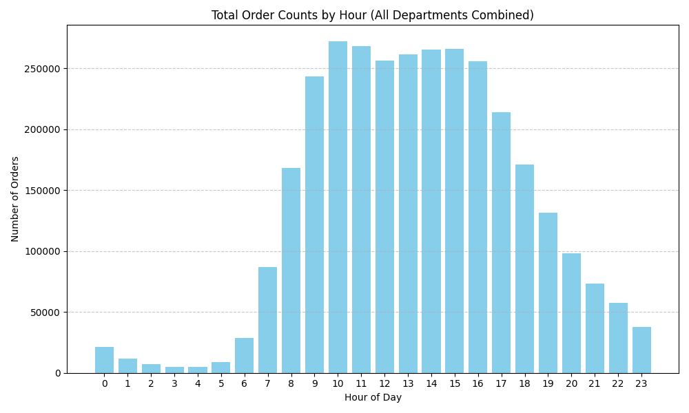
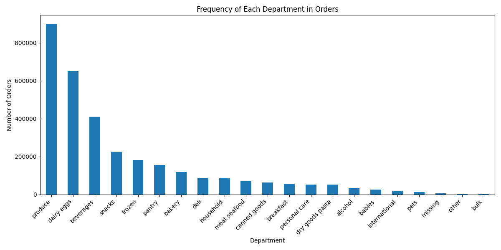

# American Statistical Association Statistics Project

## Instacart Order Behavior Analysis

An exploratory Python analysis of order-hour patterns across departments in the Instacart Market Basket Analysis dataset. The scripts summarize order hours, visualize department and aisle patterns, and compute a Kruskal–Wallis H-test. This is an observational student project, not a validated pricing model.

## Key Questions

- Do different departments have significantly different order time distributions?
- How do descriptive order-hour patterns vary across departments and aisles?

## Selected figures






## Statistical Methodology

The analysis includes:
- A rank-based omnibus comparison across departments using Kruskal–Wallis
- Ranking order times, computing department-level mean ranks, and evaluating their contributions to the test statistic
- Visualization of average order hour and product-level patterns for exploratory interpretation

### What the analysis does not establish

Kruskal–Wallis is not a test of arithmetic means; rejection indicates a difference in rank distributions, with a location/median interpretation requiring additional shape assumptions. An omnibus result does not identify which departments differ without follow-up comparisons and multiplicity control.

Rows representing items from the same order or repeated orders from the same customer are not independent observations. The current scripts do not account for that clustering, so nominal p-values must not be treated as definitive population-level evidence. Hour of day is also circular: a simple arithmetic average can obscure patterns spanning midnight.

The plotted department rank contributions are exploratory, not department-specific p-values. Their manual calculation does not include the tie correction used by SciPy's H-statistic, so they should not be interpreted as an exact decomposition of the reported test statistic.

Most importantly, order timing alone does not measure price sensitivity, causal effects, or an optimal time to raise prices. Such claims would require additional data and an appropriate study design. No significance result or pricing benefit is asserted here without a reproducible run and those methodological checks.

## Project Structure

| File                  | Description                                                                 |
|-----------------------|-----------------------------------------------------------------------------|
| `final_test.py`       | Computes the omnibus test and exploratory rank-contribution visualizations, subject to the limitations above |
| `mean_hour.py`        | Computes and visualizes the average order hour per department               |
| `order_by_hour.py`    | Visualizes order frequency across different hours of the day                |
| `rank.py`             | Ranks all order hours and computes department-level rank averages           |
| `visualize.py`        | Generates matplotlib tables for statistical summaries                       |
| `visualize_aisles.py` | Analyzes and visualizes order time patterns at the aisle level              |

## Dataset

Instacart Market Basket Analysis  
The data can be found here: https://www.kaggle.com/datasets/yasserh/instacart-online-grocery-basket-analysis-dataset
## Requirements

Make sure to download the following CSVs and place them in your working directory:

- `orders_with_department.csv`
- `products.csv`
- `departments.csv`
- `aisles.csv`
- `order_products__prior.csv`
- `orders.csv`

`orders_with_department.csv` is a derived input expected by most scripts, not a standard raw Instacart filename. Prepare it with at least `department` and `order_hour_of_day` columns. The repository does not currently provide a single end-to-end preprocessing pipeline; inspect each script's input columns before running it. The aisle script uses the raw input filenames listed above.

```bash
pip install pandas matplotlib scipy
```

From the repository root, with the required input present:

```bash
python final_test.py
python mean_hour.py
```
